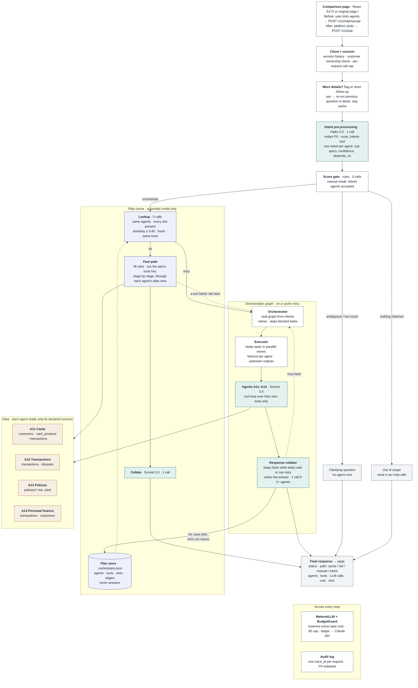

# Architecture

A customer asks one question. The platform works out which domain agents are needed, each agent uses only its own
tools and data, and the customer gets one answer.

The core rule: **LLMs understand and write; code decides.** Routing, the order agents run in, retries, timeouts and
spend limits are plain Python. An LLM only reads the question, picks tools inside an agent, and writes the answer.

## Diagram



Source: [architecture.mmd](architecture.mmd). Rendered copy for slides: [architecture.png](architecture.png).
Green boxes are LLM calls, blue is the plan cache, sand is data, and white is plain code.

## Request flow

```
POST /v1/chat  (or /v1/chat/manual with agent_ids)
  │
  ├─ Client + session        app/platform.py, app/session.py
  │    keeps history, checks the session belongs to this customer, starts a per-request LLM meter
  │
  ├─ Intent pre-processing   app/intent/preprocessor.py           1 LLM call
  │    normalises and redacts the message, then the router answers through the route_intents tool:
  │    one intent per agent (sub_query, confidence, depends_on) + an ambiguous flag
  │
  ├─ Intent score            app/intent/evaluator.py              0 LLM calls
  │    rule-based gate → orchestrate | clarify | out_of_scope
  │    clarify and out_of_scope answer straight away; no agent runs
  │
  ├─ Plan cache              app/cache/                           0 LLM calls
  │    same agents + every slot present + similar question → hit: the fast path runs the plan's tools
  │    live and one collate call writes the answer (2 LLM calls in total); miss → full graph below
  │
  ├─ Orchestration graph     app/orchestrator/
  │    Orchestrator   builds the task graph from accepted intents; on loop-back schedules retries
  │                   and skips tasks whose upstream failed
  │    Executor       runs every ready task in parallel, with a timeout per agent, and passes
  │                   upstream outputs to dependent tasks
  │    Agents         A11–A14, each an LLM tool loop over its own tools  2–4 LLM calls each
  │    Collator       loops back while tasks are waiting or retryable; otherwise writes the
  │                   final answer                                1 LLM call when 2+ agents ran
  │
  └─ Final response + audit log   app/audit/logger.py
       every stage is written under one trace_id, with card numbers, SSNs and emails redacted
```

### Manual mode (the "before" side of the comparison page)

`POST /v1/chat/manual` takes the agents the user ticked. It enters the same pipeline with two differences:

- The router only sees the ticked agents and is told not to flag ambiguity.
- The score gate is replaced by forced acceptance: every ticked agent runs, in the order the router chose.
  A ticked agent the router found nothing for gets the whole question.

Everything after that is shared, so ticking the agents a question really needs gives the same tools and answer as
automatic routing.

## Agents, tools and data

| Agent | Domain | Tools | Data sources (under `data/`) |
| --- | --- | --- | --- |
| A11 | Credit card recommendation | `get_customer_profile`, `recommend_cards` | `customers.json`, `card_products.json`, `transactions.csv` |
| A12 | Transaction queries | `search_transactions`, `get_dispute_status` | `transactions.csv`, `disputes.json` |
| A13 | Policy knowledge base | `search_policies` (cites `[POL-…]`) | `policies/*.md` |
| A14 | Personal finance | `spending_summary`, `budget_status` | `transactions.csv`, `customers.json` |

Each tool's inputs, outputs and behaviour are listed in [agents-and-tools.md](agents-and-tools.md).

Isolation is enforced in three places:

- **Tools:** an agent can only call the tools in its own list. A call to any other tool name returns an error to
  that agent.
- **Data:** each data file is loaded by one repository class (`app/data/repositories.py`). The registry gives every
  agent a `SourceView` over the sources it declares, and tools read data only through `ctx.data`. Touching an
  undeclared source raises `SourceDenied`, which the agent sees as a tool error.
- **Identity:** `customer_id` comes from the platform through `ToolContext`, never from the LLM. Tools reject
  unknown or missing arguments, so the model can't ask for another customer's data.

Tool specs are MCP-shaped (`name`, `description`, `input_schema`), so each agent's tools could be served by its own
MCP server without changes.

## LLM layer

```
MeteredLLM  ── counts calls per request, enforces the call cap, reserves and settles cost
   └─ provider
        AnthropicLLM  app/llm/anthropic_llm.py  real Claude: the app, demo and UI always use this
        MockLLM       app/llm/mock.py           deterministic stand-in for the test suite and CI only
```

| Step | Model (default) | Request settings |
| --- | --- | --- |
| Intent routing | `claude-haiku-5-5` | forced `route_intents` tool, thinking disabled |
| Agents | `claude-sonnet-5-5` | `thinking: between_tools`, model chooses tools |
| Collator | `claude-sonnet-5-5` | `thinking: between_tools` |

Thinking blocks are kept exactly as received and sent back unchanged in tool loops. Spend protection is described
in [cost.md](cost.md).

## Plan cache

The cache stores **plans, never answers**: which agent runs which tool, with which arguments, in which stage.
Tools always run live for the current customer, so data is fresh and nothing leaks between customers.

```
"What is the late payment fee, and how much did I spend on dining this month?"     (full run, 6 calls)
   → saved plan  agents [A13, A14], slots [category]
                 stage 0: A13.search_policies(query={sub_query})
                 stage 0: A14.spending_summary(query={sub_query}, category={category})

"How much did I spend on travel this month, and what's the late fee?"              (cache hit, 2 calls)
   → same agents, has a {category} (travel), similarity 0.86 ≥ 0.80
   → runs both tools live with category=travel, then one collate call
```

**Lookup** (after the score gate, automatic mode only). A plan is used when all of these hold:

- the router chose the same set of agents;
- every slot the plan needs is in the question (`category`, `merchant`, `transaction_id`, `days`, `amount`,
  found by rules in `app/cache/entities.py`); a missing slot is a miss, never a guess;
- the slot-masked questions are at least `CACHE_SIMILARITY` (0.80) similar;
- the plan is younger than `CACHE_TTL_S`, was built against the current tool schemas (a catalog hash), and has
  fewer than `CACHE_MAX_NEGATIVE` "more details" requests against it.

**Fast path** (`app/cache/fast_path.py`). Fills the slots, runs the tools stage by stage through each agent's own
data view, then makes one collate call that also gets each agent's instructions. It skips the orchestrator, the
executor and every agent's LLM loop. If any tool fails, the same request falls back to the full graph.

**Writing.** After a full run that ends `ok`, the plan is built from the tools that actually ran. A `query`
argument becomes `{sub_query}`; a value found in the question becomes its slot; settings a tool marks as
`replay_args` (`top_k`, `top_n`) stay as they are. Any other value, such as a transaction id read from an earlier
tool's output, would tie the plan to one customer's data, so that run isn't cached. The run's LLM calls, time and
cost are stored with the plan, so a later hit can show the comparison.

**More details.** `more_details: true`, or a short follow-up such as "more details please", re-runs the previous
question through the full graph and asks the collator for a fuller, itemised answer. If the previous answer came
from the cache, that plan's negative count goes up and the full run's plan replaces it. A longer message that
mentions detail is a new question and skips the cache.

**Similarity.** `HashingEmbedder` (word stems weighted double, plus character trigrams, 1,024 dimensions) runs on
the slot-masked question, so "spend on dining" and "spent on travel" compare as the same. Rewordings of the same
question score about 0.86; questions that need a different plan, such as a dispute lookup vs pending charges at
the same merchant, score about 0.66. A sentence-embedding model can replace it behind the `Embedder` interface.

**Storage.** `PlanStore` has an in-memory implementation and a JSON file implementation (`CACHE_PATH`, default
`.cache/plans.json`), so plans survive restarts. Redis with a vector index is the production implementation.
`GET /v1/cache` lists the plans; `DELETE /v1/cache` clears them. Manual mode never reads or writes the cache.

## LLM calls per request

| Question shape | Calls | Example |
| --- | --- | --- |
| Ambiguous or out of scope | 1 | "What about my card?" |
| One agent, two tools | 3–4 (router 1 + agent 2–3) | "…$89.99 Online Store 24 charge, and where is the dispute?" |
| Two agents, one tool each | 6 (router 1 + 2 + 2 + collate 1) | "What is the late payment fee, and how much did I spend on dining?" |
| One agent depends on another | 6, in two waves | "How much did I spend and which credit card suits my spending?" |
| Any plan-cache hit | 2 (router 1 + collate 1) | the late-fee question asked again, or about travel |

A single-agent answer skips the collator. On Claude, an agent can call both of its tools in one step (as A12 does
for the dispute question), which saves a call. The cap is `MAX_LLM_CALLS_PER_REQUEST` (default 12).

## Code map

```
app/
  main.py            FastAPI routes; serves the comparison page at /
  platform.py        AgentPlatform.handle(): one pipeline, two entry points
  config.py          settings from environment / .env
  models.py          Intent, Task, AgentResult, FinalResponse
  session.py         in-memory sessions with a customer ownership check
  intent/            router (preprocessor.py) and score gate (evaluator.py)
  orchestrator/      graph, orchestrator, executor, collator, state
  agents/            base Agent, registry, one module per agent
  tools/             Tool contract, ToolContext, @tool decorator
  data/              repositories over data/ and per-agent SourceViews
  cache/             plan cache: entities.py (slots), embedder.py, plan_cache.py (store + rules), fast_path.py
  llm/               mock, Anthropic provider, MeteredLLM, BudgetGuard
  audit/             JSONL audit logger with redaction
  static/index.html  original single-file comparison page (served at /); the built React app is served at /app/
data/                the demo's data files
frontend/            React app (Vite + TypeScript): the same comparison page as components
  src/api.ts         typed calls to the backend
  src/compare.ts     the before/after comparison rules
  src/components/    Header, AskBar, ComparisonStrip, AgentPicker, Turn
tests/               test suite (no API calls), including a fake Anthropic client
scripts/scale_check.py   times the tools on a million generated transactions
```

## Scaling the data

Agents never see raw tables. Tools query a repository for one customer and return totals plus at most 20 rows,
so the prompt, the latency and the cost of a question stay flat as the data grows.

`python scripts/scale_check.py` measures it with 1,000,000 generated transactions across 10,000 customers. Each tool
call takes about 0.1 ms; the file-based store loads in about 2 seconds and uses about 600 MB. That in-memory store is
the demo's limit, not the design's: past one machine's memory, or with several API instances, replace the repository
classes with a database (indexes on `customer_id` and `date`) and keep their methods. No agent or tool changes.

## Moving to production

Every piece of state sits behind a small interface, so production means swapping implementations:

| Demo | Production |
| --- | --- |
| `data/` files via repository classes | systems of record, one repository class per source |
| keyword search over policy paragraphs | embeddings + a vector store (e.g. pgvector) |
| in-memory sessions | Redis |
| plan cache in a JSON file | Redis with a vector index |
| JSONL audit file | OpenTelemetry traces + append-only audit store |
| `customer_id` in the request body | taken from the auth token |
| in-process agents | one MCP server per agent domain, scaled independently |
| local spend ledger | Console workspace limit + central usage reporting |
